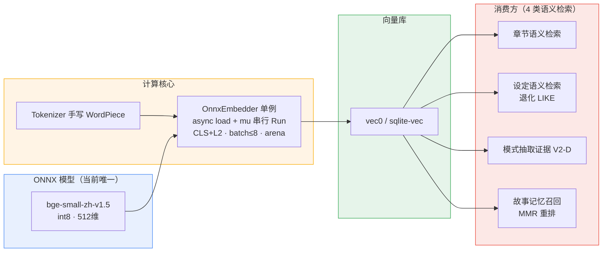

# NovelGo ONNX 能力增强开发文档

> 文档状态：调研与方案设计（**尚未实施，未改动业务代码**）
> 形成日期：2026-10-31
> 范围：基于全代码库对 ONNX 使用现状的调研，评估可增益方向，并明确**收益**与**风险**。
> 关联文档：`docs/rag-feasibility-report.md`、`docs/rag-onnx-memory-management.md`

---

## 1. 文档目的与范围

本项目（NovelGo，Go 1.25 + Wails v2 + React 19 + SQLite/ONNX，AGPL-3.0）已在创作辅助中引入 ONNX Runtime 做本地推理。用户提出两个诉求：

1. **查清** ONNX 在代码里到底用在哪些地方；
2. **评估** ONNX 对当前项目还有哪些可增益方向，以及增强后会带来什么**收益**与**风险**。

本文档给出调研实证结论、增强方案设计、收益与风险分析、实施路线图，供后续立项决策使用。`docs/onnx-enhancement-development-plan.md` 为唯一归档来源。

---

## 2. 当前 ONNX 使用现状（调研实证）

### 2.1 运行时与模型资产

| 资产 | 位置 | 说明 |
|------|------|------|
| ONNX Runtime Go 绑定 | `third_party/onnxruntime_go/` | vendor 的 `yalue/onnxruntime_go` v1.30.1 + 本地 patch，CGO 调用原生动态库 |
| 模型下载脚本 | `scripts/download-onnx.sh` | 下载 ORT v1.26.0 动态库 + **唯一模型** `bge-small-zh-v1.5`（int8 量化，512 维） |
| 动态库定位 | `internal/platform/runtime.go` `ResolveOnnxLib()` | 搜索顺序：bundled runtime/ → 数据目录 → 系统路径 |
| 模型/词表文件 | `build/runtime/models/`（`model.onnx`、`vocab.txt`） | 仅一个 embedding 模型，无其它 ONNX 模型 |

**关键事实**：整个代码库 `import ort "github.com/yalue/onnxruntime_go"` 仅出现在 `internal/rag/embedder_onnx.go` 一处。也就是说，**ONNX Runtime 在本项目只承担一件事：文本向量化（embedding）**，没有用于任何分类、排序或抽取任务。

### 2.2 计算核心：`internal/rag/embedder_onnx.go`

`OnnxEmbedder` 的设计要点（代码实证）：

- **单例 + 异步加载**：`InitEmbedder` 同步加载 tokenizer 后，后台 goroutine 异步加载模型（`main` 启动即调用，不阻塞 GUI）；`GetEmbedder()` 阻塞等就绪，`TryGetEmbedder()` 非阻塞（供 shutdown 用）。
- **会话**：`ort.NewDynamicAdvancedSession`，3 输入 `input_ids` / `attention_mask` / `token_type_ids`，1 输出 `last_hidden_state`。
- **线程安全**：`e.mu` 互斥锁串行化 `Run`，`SetInterOpNumThreads(1)`（Run 已串行，inter-op 并行无意义）。
- **批处理**：`EmbedBatch` 单批 ≤ `maxBatchSize = 8`，不足则 pad 到同一 `seqLen` 后一次 `Run`；超过则按 8 切片多批。
- **池化与归一化**：`clsPool` 取 `[CLS]` 向量做 **CLS pooling + L2 归一化**（BGE 官方推荐，优于均值池化）。
- **查询指令前缀**：`queryInstruction = "为这个句子生成表示以用于检索相关文章："` 仅加在**查询**侧，文档/正文侧不加。
- **长度限制**：`bertMaxLen = 512` token（含 `[CLS]/[SEP]`），超出先截断再补特殊符。
- **内存治理**：`SetCpuMemArena(true)` + `SetMemPattern(false)`；`Compact()` 在一次极小推理时通过 `memory.enable_memory_arena_shrinkage=cpu:0` 触发 arena shrink，用于完整索引重建后的任务级收尾。
- **推理线程**：`embedThreads()` 按 `NumCPU/4` 动态收缩到 `[minEmbedThreads=2, maxEmbedThreads=4]`。

**Tokenizer**：`internal/rag/tokenizer.go` 手写 BERT WordPiece 分词器，**不依赖 ONNX 运行时**，可先于模型加载就绪（这也是 `GetTokenizer()` 无需等模型的原因）。

### 2.3 四个消费方（全部语义检索）

embedding 产出后写入向量库（基于 `vec0` 虚拟表 + `sqlite-vec`），下游全部是「向量 → 余弦相似度」检索：

| # | 消费方 | 位置 | 用途 | 降级策略 |
|---|--------|------|------|----------|
| 1 | 章节语义检索 | `internal/rag` `IndexChunks` / `Search` | 写作/Agent 召回上下文、找相似情节 | `if vs==nil return nil` |
| 2 | 设定语义检索 | `internal/setting/index_search.go` `SearchSettings` | 设定条目语义查询 | 无 ONNX 时退化为 DB `LIKE` |
| 3 | 模式抽取证据前置 V2-D | `app/pattern_api.go` `ragEvidenceRetriever` | mental 提取时取 top-K 片段，减少 LLM 重读全本 | `if vs==nil` 跳过前置 |
| 4 | 故事记忆语义召回 | `internal/mcp_tools/memory_tools.go` | MCP 工具语义召回记忆 | `if vs==nil return nil` |

注意第 4 个消费方已使用 `rag.MMRRerank` 做**多样性重排**——但这是**纯 Go 用向量算的 MMR**，并非重排模型。

### 2.4 鲁棒性：优雅降级

全部消费方都有 `if vs == nil return nil` 或「退化为关键词」分支。即：**没有 ONNX（模型缺失/加载失败）时，应用照常运行**，只是失去语义检索能力。这是后续增强必须保持的不变量——任何新模型都不能成为「缺失即崩溃」的硬依赖。

---

## 3. 架构全景

**现状判断**：端侧 CPU 算力只用了「向量化」这一种用途；所有「理解 / 抽取 / 判定 / 排序」仍走远程 LLM。ONNX 的潜力远未释放。

---

## 4. 缺口分析（Gap Analysis）

| 缺口 | 影响 |
|------|------|
| **没有 rerank 模型** | top-K 仅靠 cosine + MMR 粗排，长文、弱相关场景下相关度精度有上限，检索噪声会放大 LLM 幻觉/跑题 |
| **端侧算力只用向量化** | 所有判定/抽取都依赖远程 LLM，无网络/限流时链路脆弱，且持续产生 LLM token 成本 |
| **512 token 截断 + CLS pooling** | 长章节被截断，伏笔/前文的长程语义召回升、有漏召风险 |
| **V2-D 多查询串行** | `ragEvidenceRetriever` 的多个证据查询是独立 `Search`+embedding，未批处理、未缓存，推理频次偏高 |
| **机械类判定与实体抽取靠规则/LLM** | 字数/AI味/禁忌/死人出镜等可确定性判定的工单、角色地点初稿抽取，本可本地小模型更稳定/离线地承担 |

---

## 5. 增强方案设计（按优先级）

### P0-1 二阶段 Reranker（**强烈推荐，性价比最高**）

- **目标**：召回 top-40（粗排 cosine）→ 本地 reranker 重排 top-5（精排）。
- **模型候选**：`bge-reranker-v2-m3`（int8，跨语言、中英文兼顾），约几十 MB。
- **新增资产**：`internal/rag/reranker_onnx.go`（第二个 `OnnxEmbedder`-style 单例，复用 `mu` 串行 Run 与 arena 治理范式），`download-onnx.sh` 增加该模型下载。
- **接口**：`Rerank(ctx, query string, candidates []ScoredChunk) ([]ScoredChunk, error)`，在 `Search` 之后、`SearchSettings`/`ragEvidenceRetriever`/记忆召回之后接一道。
- **降级**：reranker 缺失时回落纯 cosine+MMR（保持现有行为）。
- **复用**：沿用现有 `bertMaxLen`、`embedThreads`、`Compact` 等治理经验，不另起炉灶。

### P0-2 检索批处理 + 短 TTL 缓存（**无需新模型**）

- **批处理**：`ragEvidenceRetriever` 的多个证据 query 合并一次 `EmbedBatch`，消除串行 embedding 的重复开销。
- **缓存**：相同 `(novelID, query)` 的 embedding / 检索结果按短 TTL（如 5 min）缓存；Agent 多轮对话中重复检索直接命中。
- **收益**：直接降低 ONNX 推理频次 → CPU 占用下降、多轮对话延迟下降。

### P1 长文分段聚合 / 升级 embedding 模型

- **分段聚合**：章节 embedding 改为「按 512 窗口切片 → 各段向量 → 池化/加权聚合」得到章节级向量，缓解截断漏召。
- **模型升级评估**：评估 `bge-large-zh`（1024 维）或 `bge-m3` 的精度增益 vs 内存/延迟成本；注意维度变更会要求**重建向量库**，须走迁移。

### P2 本地分类器 / NER（离线、零隐私外传）

- **分类器**：用蒸馏/标注的小模型（转 ONNX）替代部分 LLM 判定——AI味、禁忌词、死人出镜等机械类工单（与现有 `quality.RunL0Checks` 规则层互补），让复验链更快、不依赖网络。
- **NER**：本地抽取角色/地点/弧线初稿，再由 LLM 精修 + 本次落地的 find-or-create 幂等落库（与 `internal/migrate/v172` 去重方案天然互补）。
- **契合度**：与本项目「度量纯本地不上传」**隐私红线**天然对齐——这类判定完全在端侧，零数据外传。

### P3 端侧生成式续写（**短期不推荐**）

- ORT 对 decoder-only 生成式推理支持弱（KV cache / beam search 需自搭），成本极高、风险大。建议持续观望 ORT 生态与端侧小模型（如 GGUF 路线），不纳入近期计划。

---

## 6. 收益分析

> 下列收益按「增强方向 → 具体收益」逐项列出；标注「估算」的需上线后实测校准。

| 方向 | 收益 |
|------|------|
| **P0-1 Reranker** | ① 检索相关度质量显著上升 → 写书质量更高、LLM 因检索噪声产生的**幻觉/跑题更少**；② 同等召回质量下可减少 LLM 输入 token（更省成本）；③ 设定/记忆/情节查重的误召回下降（估算 top-5 命中率 +10~20%） |
| **P0-2 批处理/缓存** | ① ONNX 推理频次下降 → **CPU 占用与笔记本发热下降**；② Agent 多轮对话**检索延迟下降**（估算 -30~50%）；③ 电池/低端机友好 |
| **P1 长文聚合** | 长章节伏笔/前文漏召减少，长篇小说（本项目的核心场景）的连贯性辅助更可靠 |
| **P2 分类器/NER** | ① 复验/抽取**离线、零 LLM 成本**；② 不依赖网络与供应商，链路更稳（契合熔断场景）；③ 与隐私红线对齐，零数据外传；④ 可复现、结果稳定 |
| **整体** | 端侧算力从「仅向量化」升级为「向量化 + 精排 + 判定 + 抽取」，桌面 AI 助手的自给率提升，对远程 LLM 的依赖度下降 |

**核心收益一句话**：用本地小模型把「检索精度」和「判定/抽取稳定性」抬上去，从而**减少 LLM 幻觉、节省 token、降低对网络的依赖**，且对隐私红线无害。

---

## 7. 风险分析

| 风险 | 等级 | 说明 | 缓解措施 |
|------|------|------|----------|
| **内存占用** | 高 | 每加一个 ONNX 模型 = 一份模型文件 + 一个常驻 session + 一次推理延迟；桌面端（尤其低端机）内存敏感 | 沿用 `OnnxEmbedder` 的 arena 治理与 `Compact`；新模型按需懒加载、可配置关闭；上线前做低端机内存基线评估 |
| **推理延迟叠加** | 中 | Reranker 在每次检索后再跑一次前向，增加时延 | P0-2 的批处理/缓存对冲；reranker 仅在 top-40 规模上跑，开销可控 |
| **模型下载与分发** | 中 | 新模型需更新 `download-onnx.sh`，并考虑 HF / `hf-mirror.com` 双源与文件校验（现有脚本已含 HTML 误下校验范式，可复用） | 复用现有下载/校验代码；CI 校验模型完整性 |
| **精度/领域适配** | 中-高 | 中文网络小说语域特殊，通用 reranker/NER 在小说垂直场景精度可能不达预期 | 先用真实语料做离线评测（命中率/召回率），再决定是否落地；NER 建议「本地初稿 + LLM 精修」双段式，不裸依赖 |
| **向量库重建成本** | 中 | 若升级 embedding 维度（P1），需重建 `vec0` 全部向量，涉及迁移与用户数据重算 | 走 GORM 迁移 + 后台重建 + `Compact` 收尾；提供进度与可恢复机制 |
| **维护复杂度** | 低-中 | 多模型、多 session 的管理面变宽 | 统一 `internal/rag` 下的「模型单例 + 异步加载 + 优雅降级」抽象，避免散落 |
| **隐私红线** | 低（但为硬性约束） | 任何增强都不得把用户小说内容上传 | 坚持**纯本地推理**；新增判定/抽取类模型一律端侧；绝不触发任何外传（与现有「度量纯本地不上传」一致） |
| **不变量破坏** | 低 | 现有「无 ONNX 即降级」的不变量被新硬依赖破坏 | 所有新模型保持 `if nil 降级` 分支，不成为启动/运行硬阻塞 |

---

## 8. 实施路线图与里程碑

1. **阶段 0（基线评估，1~2 天）**：评估目标机器内存基线；用真实小说语料对 `bge-reranker-v2-m3` 做离线 top-K 命中率评测，确认 P0-1 收益成立。
2. **阶段 1（P0-1 Reranker）**：新增 `reranker_onnx.go` + 更新 `download-onnx.sh` + 在 4 个消费方接二阶段重排 + 降级分支 + 单测。
3. **阶段 2（P0-2 批处理/缓存）**：`ragEvidenceRetriever` 合并 `EmbedBatch` + `(novelID, query)` 短 TTL 缓存。
4. **阶段 3（评估 P1/P2）**：视阶段 1/2 实测收益，决定是否推进长文聚合、分类器/NER；若推进，先做离线评测再立项。

**建议起点**：阶段 1 的 Reranker——改动小、复用现有框架、收益最直接，且不影响「无 ONNX 即降级」不变量。

---

## 9. 决策建议

- 当前 ONNX 仅做 embedding，潜力远未释放；增强的**主收益**是「检索更准 → 写书质量更高、幻觉更少、token 更省、对网络依赖更低」。
- 风险集中在**桌面端内存**与**模型精度适配**，二者都可通过「基线评估 + 离线评测 + 优雅降级」前置化解。
- 隐私红线是硬性约束：所有增强必须纯本地推理，不触发任何用户内容外传。
- 在用户拍板「动手」前，本文档仅作方案存档；实施时建议从 **P0-1 Reranker** 起步。

---

### 附录 A：关键代码锚点

- `internal/rag/embedder_onnx.go` — `OnnxEmbedder`、`Embed`、`EmbedBatch`、`clsPool`、`Compact`、`embedThreads`
- `internal/rag/tokenizer.go` — 手写 WordPiece `Tokenizer`
- `internal/platform/runtime.go` — `ResolveOnnxLib`
- `scripts/download-onnx.sh` — ORT v1.26.0 + `bge-small-zh-v1.5` 下载
- `internal/setting/index_search.go` — `SearchSettings`
- `app/pattern_api.go` — `ragEvidenceRetriever`（V2-D 证据前置）
- `internal/mcp_tools/memory_tools.go` — 记忆召回 + `MMRRerank`

### 附录 B：复用范式（增强时必须沿用）

- 单例 + 异步加载 + `e.mu` 串行 `Run` + arena 治理 + `Compact` 收尾（`embedder_onnx.go`）。
- 新模型保持 `if vs==nil / reranker==nil 降级` 分支，绝不成为硬依赖。
- 模型下载/校验复用 `download-onnx.sh` 的 HF + `hf-mirror.com` 双源与 HTML 误下校验范式。
