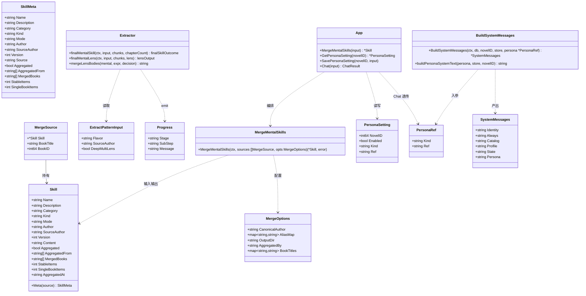
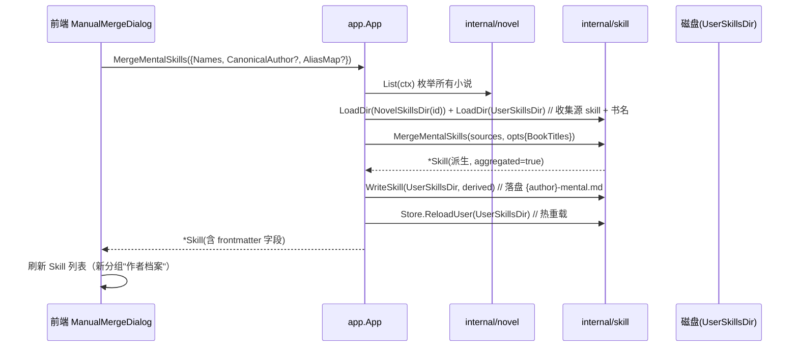
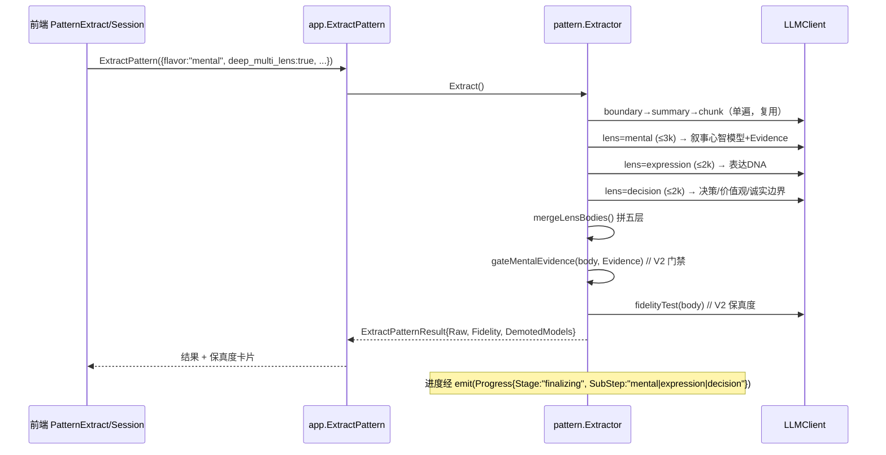
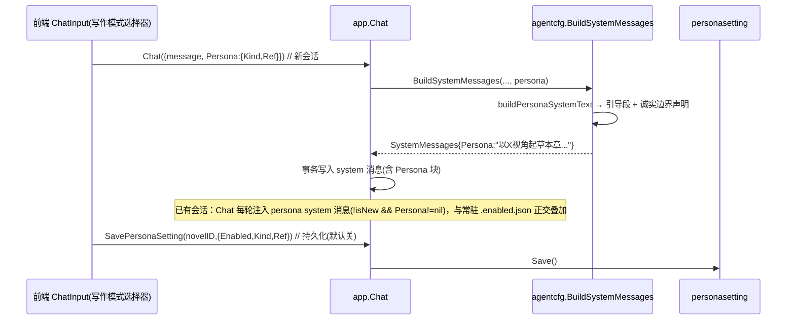

# NovelGo V3 系统设计 + 任务拆分（架构师：高见远）

> **⚠️ 历史设计快照**：本文是 V3（跨书聚合 / 多镜头精提 / 写作闭环增强）开工前的设计与任务拆分，部分条目已实现入库、部分为规划态。**现状以代码为准**，护栏与能力清单见 `docs/TECHNICAL_STATUS_AND_GUARDRAILS.md`。

> 基于 V3 创作心智提取增量 PRD。范围：跨书聚合（P0）/ 多镜头精提（P1）/ 写作闭环增强（P2）。
> 仅做设计文档与有序任务列表，不写实现代码。

---

## 0. 设计基线确认（摘要）

| 既有事实 | 对 V3 的约束 |
|---|---|
| skill 真相源 = `skills/{name}.md` 文件，frontmatter 透传消费 | V3 聚合产物必须是"另一个 .md"，零改动复用扫描/注入链路 |
| `internal/skill/store.go` 内存扫描 + `ParseBytes` 解析；无 skill DB 表 | 不引入 skill DB 表；派生文件落盘即可被现有 `ListMeta`/`BuildAlwaysSkillsContent` 消费 |
| `finalMentalSkill` 单轮 8k 护栏（`mentalFinalMaxTokens=8000`） | 多镜头把 final 拆 3 路，合计 ≤7k，单轮护栏不破 |
| `BuildSystemMessages` 仅在**新会话**事务外构建一次 | persona 注入需双路径：新会话写常驻块 + 已有会话每轮注入 |
| Wails 绑定 `models.ts`/`App.d.ts`/`App.js` 由 `wails generate module` 生成 | 任何 Go 结构体/方法变更后必须 regen（当前 `SkillMeta` 已缺 `kind`/`source_author`，证实 stale） |
| `writingconfig` 是"每本书工具设置"的范式（DB 表 + Get/Save 幂等） | persona 持久化仿此新建 `personasetting` 包 |

---

## 1. 实现方案 + 框架选型

### 1.1 框架/依赖选型
- **不引入任何新三方依赖**。后端复用 `gopkg.in/yaml.v3`（frontmatter 解析）、`gorm.io/gorm`（仅枚举小说列表与 persona 持久化）、`wails`；前端复用现有 React19/Vite/Tailwind v4/shadcn/zustand/react-query。
- ONNX embedder / VectorStore / RefreshQueue 维持全局 singleton，V3 不新增实例。

### 1.2 三大子项的分层落点（硬规则：多介质/多领域走 `App→internal/<domain>`，禁止反向依赖 `app/` 或 Wails）

| 子项 | 落点 | 理由 |
|---|---|---|
| **AGG 跨书聚合** | 纯函数 `internal/skill.MergeMentalSkills`（`aggregate.go`）+ `app.MergeMentalSkills` 编排（枚举源 skill → 调 Merge → `skill.WriteSkill` 落盘派生文件 → `Store.ReloadUser` 热重载） | 跨"多本小说目录 + 用户目录"多介质，属派生计算；用包级函数保持轻量，避免引入 Service 结构体。DB 仅用于枚举小说列表，**不引 skill DB 表**（见 1.3）。 |
| **ML 多镜头精提** | `internal/pattern/extract.go` 内 `finalMentalSkill` 增加"多镜头分支"；进度复用 `Progress.SubStep` | 仅改造 final 阶段内部，不动外层 `boundary→summary→chunk` 单遍管线，零回归。 |
| **WC 写作闭环** | `internal/agentcfg.BuildSystemMessages` 增 `persona *PersonaRef` 入参 + 新增 `buildPersonaSystemText`；`app/chat.go` 透传并在新会话/每轮注入；持久化走新 `internal/personasetting` | persona 是"写作模式开关"，与 `.enabled.json` 常驻启用正交，故独立存储。 |

### 1.3 为何不引入 skill DB 表
- skill 体系以 `.md` 为唯一真相源，注入链路（`ListMeta`→`BuildAlwaysSkillsContent`/`BuildSkillCatalog`）全按 frontmatter 消费。落盘派生 `.md` 可**零改动**被现有扫描与注入复用。
- 引入 DB 表会造成"文件 + 表"双真相源，更新/删除时必须双写且易不一致；落盘方案把一致性责任收敛到"文件即真相"，符合既有约定。
- 弱点（源 skill 更新后派生文件过期）由 frontmatter 记录 `aggregated_from`/`merged_books`/`aggregated_at` + UI 提示 + 手动重建覆盖，不引入文件监听（PRD 已定）。

---

## 2. 文件列表（新建 / 修改）

### 后端（Go）
| 文件 | 变更 | 说明 |
|---|---|---|
| `internal/skill/aggregate.go` | **新建** | `MergeMentalSkills`、`MergeOptions`、`MergeSource`、作者名归一（trim+大小写折叠+可选别名）、条目级对齐/加权、尾注生成、派生 frontmatter 组装 |
| `internal/skill/save.go` | **新建** | `Serialize(sk *Skill) (string,error)` + `WriteSkill(dir string, sk *Skill) error`：含 `aggregated` 系列字段的 frontmatter 序列化与落盘（供聚合与将来复用） |
| `internal/skill/types.go` | **改** | `Skill` 增加 `Aggregated bool`、`AggregatedFrom []string`、`MergedBooks []string`、`StableItems int`、`SingleBookItems int`、`AggregatedAt string`（yaml/json tag）；`SkillMeta` 同步增加上述 + 补全 `Kind`/`SourceAuthor`（当前 TS 绑定缺失，regen 后补全） |
| `internal/skill/store.go` | **改** | 新增导出 `LoadDir(dir string) ([]Skill, error)`（包 `scanDir` 的封装，供 app 枚举跨书源）；新增 `GroupByAuthor(metas) map[string][]SkillMeta` 辅助（AGG-7 分组） |
| `internal/pattern/types.go` | **改** | `ExtractPatternInput` 增 `DeepMultiLens bool`；`Progress` 增 `SubStep string`；新增三镜头中间类型 `lensOutput{Content string; Evidence []ModelEvidence}` |
| `internal/pattern/extract.go` | **改** | `finalMentalSkill` 增加多镜头分支；新增 `finalMentalLens`（3 路聚焦调用，合计 ≤7k）、`mergeLensBodies`（拼五层）、进度 `emit` 带 `SubStep` |
| `internal/agentcfg/system_messages.go` | **改** | `BuildSystemMessages` 增 `persona *PersonaRef` 入参；`SystemMessages` 增 `Persona string` 字段；新增 `buildPersonaSystemText`、`resolvePersonaContent` |
| `internal/agentcfg/persona.go` | **新建** | `PersonaRef{Kind string; Ref string}` 类型定义（Wails 绑定自动生成 TS 类）；诚实边界固定声明文案常量 |
| `internal/personasetting/types.go` | **新建** | `PersonaSetting{NovelID int64; Enabled bool; Kind string; Ref string}` + `TableName()` |
| `internal/personasetting/store.go` | **新建** | `Get(ctx, novelID)` / `Save(ctx, *PersonaSetting)`（仿 `writingconfig`，幂等 upsert） |
| `app/skill_api.go` | **改** | 新增 `MergeMentalSkills(input MergeMentalSkillsInput) (*skill.Skill, error)`、`RebuildAggregated(input) (*skill.Skill,error)`；`MergeMentalSkillsInput{NovelID; Names []string; CanonicalAuthor string; AliasMap map[string]string}` |
| `app/persona_api.go` | **新建** | `GetPersonaSetting(novelID) (*personasetting.PersonaSetting, error)`、`SavePersonaSetting(novelID, input) error` |
| `app/chat.go` | **改** | `ChatInput` 增 `Persona *agentcfg.PersonaRef`；`Chat` 在 `isNew` 时透传 `input.Persona` 给 `BuildSystemMessages`，在 `!isNew && input.Persona!=nil` 时按轮注入 persona system 消息（防与常驻块重复） |
| `frontend/src/lib/wailsjs/go/models.ts`、`App.d.ts`、`App.js` | **重生成** | 执行 `wails generate module`；**禁止手改**（如需微调仅允许顶层命名空间 + `ExtractPatternResult` 的 `convertValues`） |

### 前端（TS/TSX）
| 文件 | 变更 | 说明 |
|---|---|---|
| `frontend/src/components/pattern/PatternExtractView.tsx` | **改** | 仅 `flavor=mental` 显示"深度多镜头"开关；来源作者下加"合并已存在同作者心智"软提示 + "手动合并"入口按钮 |
| `frontend/src/components/pattern/PatternSessionView.tsx` | **改** | 透传 `deepMultiLens` 到 `ExtractPattern` 调用 |
| `frontend/src/components/pattern/PatternProgressView.tsx` | **改** | `deepMultiLens && isMental` 时 finalizing 阶段渲染三步步进器（读 `progress.sub_step`） |
| `frontend/src/components/skill/SkillList.tsx` | **改** | 新增"创作心智·作者档案"分组（按 `source_author` + `aggregated=true`）；聚合卡显示"合并自 N 本"、stable/single-book 比例、`merged_books` 与"重建"按钮 |
| `frontend/src/components/skill/ManualMergeDialog.tsx` | **新建** | 弹窗：勾选多个 mental skill → 调 `MergeMentalSkills` |
| `frontend/src/components/chat/ChatInput.tsx` | **改** | 写章输入区加"写作模式"选择器（默认 / 以某作者心智）；选中显示 persona 徽标，一键关闭 |
| `frontend/src/components/chat/usePersonaOptions.ts` | **新建** | 返回按 `source_author` 分组的 mental/聚合档案选项 |
| `frontend/src/components/chat/usePersonaSetting.ts` | **新建** | `usePersonaSetting(novelId)` / `useSavePersonaSetting(novelId)` |
| `frontend/src/components/skill/useSkills.ts` | **改** | 透出聚合分组所需的 `aggregated`/`merged_books`/`stable_items`/`single_book_items` 等字段 |
| `frontend/src/i18n/locales/zh-CN.json`、`en.json` | **改** | 新增 `extract.deepMultiLens`、`extract.mergeHint`、`extract.manualMerge`、`skill.authorProfile*`、`chat.writingMode*`、`chat.persona*` 等键 |

---

## 3. 数据结构与接口（类图 / 伪代码）

### 3.1 关键结构（类图）



### 3.2 `MergeMentalSkills` 签名与算法（伪代码）

```go
// internal/skill/aggregate.go

// MergeSource 携带来源 skill 及其书名溯源（书名用于尾注与 merged_books）。
type MergeSource struct {
    Skill     *Skill
    BookTitle string // 来源书名；user 级可为 "用户"
    BookID    int64  // 仅 novel 级有值
}

type MergeOptions struct {
    CanonicalAuthor string            // 归一后的作者名（派生文件 source_author / 文件名前缀）
    AliasMap        map[string]string // 别名→规范名（可选，AGG-2）
    OutputDir       string            // 派生文件落盘目录（通常 config.UserSkillsDir()）
    AggregatedBy    string            // 写 author 字段，默认 "aggregate"
    BookTitles      map[string]string // skill.Name → 书名（尾注与 merged_books 用）
}

// MergeMentalSkills 将同一规范作者的多本 mental skill 聚合为一个派生 skill。
// 以"五层结构里的习惯条目"为对齐单元（非整文件拼接）。
func MergeMentalSkills(ctx context.Context, sources []MergeSource, opts MergeOptions) (*Skill, error) {
    // 1. 作者名归一：trim + 大小写折叠；应用 AliasMap（AGG-2）
    // 2. 按"条目名 + 所属层"对齐分组
    // 3. 跨书复现(≥2 源) → stable:true、合并 appears_in:[books]、证据章节去重、高权重；
    //    仅单书 → stable:false（single-book），不计入稳定总集，UI 标"待跨书验证"
    // 4. 正文每条目尾注：> 来源：《X》（第 N 章）
    // 5. 组装派生 Skill：
    //    name = SanitizeFileName(CanonicalAuthor + "-mental")
    //    frontmatter: kind=mental / aggregated=true / aggregated_from=[源名...] /
    //                merged_books=[去重书名] / source_author=CanonicalAuthor /
    //                author=AggregatedBy / stable_items / single_book_items / aggregated_at=RFC3339
    // 6. 返回 *Skill（不在此落盘；落盘由调用方 WriteSkill 完成）
}
```

**派生 skill frontmatter 权威字段表**（聚合产物唯一真相）：

| 字段 | 类型 | 必填 | 说明 |
|---|---|---|---|
| `name` | string | ✓ | `{SanitizeFileName(canonicalAuthor)}-mental` |
| `description` | string | ✓ | `创作心智·{canonicalAuthor} 跨书聚合档案` |
| `category` | string | ✓ | `创作心智` |
| `kind` | string | ✓ | `mental` |
| `mode` | string | ✓ | `auto`（可被勾选启用；不默认 always） |
| `author` | string | ✓ | `aggregate` |
| `source_author` | string | ✓ | 归一后的规范作者名 |
| `aggregated` | bool | ✓ | `true`（区分普通 skill） |
| `aggregated_from` | string[] | ✓ | 参与合并的源 skill 名清单 |
| `merged_books` | string[] | ✓ | 去重后的来源书名清单 |
| `stable_items` | int | | 跨书复现（stable）条目数 |
| `single_book_items` | int | | 单书（single-book）条目数 |
| `aggregated_at` | string | ✓ | RFC3339 时间 |
| `version` | int | ✓ | `1` |

### 3.3 多镜头 `finalMentalSkill` 内部三路调用

```go
// internal/pattern/extract.go（片段）

const (
    lensExprMaxTokens  = 2_000 // 表达镜头
    lensMentalMaxTokens = 3_000 // 心智镜头
    lensDecisionMaxTokens = 2_000 // 决策镜头
    // 合计 ≤ 7_000 < mentalFinalMaxTokens(8_000) 护栏
)

func (e *Extractor) finalMentalSkill(ctx, input, chunks, chapterCount) (finalSkillOutcome, error) {
    if input.DeepMultiLens {
        return e.finalMentalMultiLens(ctx, input, chunks, chapterCount)
    }
    // —— 原有单轮逻辑不变（零回归）——
    ...
}

func (e *Extractor) finalMentalMultiLens(ctx, input, chunks, chapterCount) (finalSkillOutcome, error) {
    // 三路聚焦 final（boundary/summary/chunk 已单遍完成，复用 chunks）
    mental  := e.finalMentalLens(ctx, input, chunks, "mental",  lensMentalMaxTokens)   // 叙事心智模型 + Evidence
    expr    := e.finalMentalLens(ctx, input, chunks, "expression", lensExprMaxTokens)  // 表达DNA
    decision:= e.finalMentalLens(ctx, input, chunks, "decision", lensDecisionMaxTokens)// 决策启发式+价值观/反模式+诚实边界
    body := mergeLensBodies(mental, expr, decision) // 按五层 canonical 顺序拼装
    // V2 门禁/保真度在合并后五层正文上照常运行（ML-5）：
    demoted, gateNote := gateMentalEvidence(body, mental.Evidence)
    fidelity := e.fidelityTest(ctx, input, chunks, body)
    return finalSkillOutcome{Raw: buildMentalSkillMarkdown(...), Fidelity: fidelity, DemotedModels: demoted}, nil
}
```

### 3.4 `BuildSystemMessages` 新增 persona 入参

```go
// internal/agentcfg/persona.go
type PersonaRef struct {
    Kind string `json:"kind"` // "skill" | "author"
    Ref  string `json:"ref"`  // skill 名 或 规范 source_author
}

// internal/agentcfg/system_messages.go
func BuildSystemMessages(ctx, db, novelID, skillStore *skill.Store, persona *PersonaRef) (*SystemMessages, error) {
    msg := &SystemMessages{Identity: AgentIdentity(MainAgent)}
    if skillStore != nil {
        all := skillStore.ListMeta(novelID)
        msg.Always = BuildAlwaysSkillsContent(all, skillStore, novelID)
        // ... catalog 同前
    }
    if persona != nil {
        msg.Persona = buildPersonaSystemText(persona, skillStore, novelID)
    }
    // profile/state 同前
    return msg, aggErr
}

// 诚实边界声明（尊重 PRD WC-5）：推断自虚构文本，不代表真实作者意图
const personaHonestyNote = "注意：以下创作心智推断自虚构文本，仅供参考，不得作为真实作者意图的断言。"
```

---

## 4. 程序调用流程（时序图 / 步骤）

### 4.1 手动合并触发链（AGG-5）



### 4.2 多镜头提取链（ML）



### 4.3 persona 注入链（WC）



---

## 5. 有序任务列表（按实现顺序，含依赖）

> 推荐分期：P0 跨书聚合（核心数据基础）→ P1 多镜头精提 → P2 写作闭环。
> 最小可用切片 = AGG-1/2/3/4/5/7。
> **Wails 重生成（T-X1）是跨所有 Go 字段/方法变更的阻断项，必须在任何前端任务与 `App.*` 变更之后执行。**

### P0 — 跨书聚合（已完成 ✅）
- **T-AGG-1｜派生 skill 数据模型 + 序列化落盘** — 已完成
  - 文件：`internal/skill/types.go`（Skill/SkillMeta 增字段）、`internal/skill/save.go`（新建 `Serialize`/`WriteSkill`）
  - 依赖：无
  - 验证：`go build ./...`；`WriteSkill` 落盘文件可被 `ParseFile` 反解析且 frontmatter 字段齐全
- **T-AGG-2｜聚合算法 `MergeMentalSkills`** — 已完成
  - 文件：`internal/skill/aggregate.go`（新建）、`internal/config`（仅复用 `UserSkillsDir`/`NovelSkillsDir`）
  - 依赖：T-AGG-1
  - 验证：`go test ./internal/skill -run Merge` 覆盖 ①作者名归一（trim+大小写折叠+别名）②跨书复现→`stable:true`+`appears_in` ③单书→`single-book` ④尾注格式 ⑤`merged_books` 去重
- **T-AGG-3｜App 合并编排 + 跨书枚举 + 热重载** — 已完成
  - 文件：`app/skill_api.go`（增 `MergeMentalSkills`/`RebuildAggregated`）、`internal/skill/store.go`（增 `LoadDir`、`GroupByAuthor`）、`internal/novel`（仅调用 `List`）
  - 依赖：T-AGG-1、T-AGG-2
  - 验证：`go test ./app` Mock store 验证枚举+合并+落盘+ReloadUser 调用
- **T-AGG-4｜前端作者档案分组 + 聚合卡 + 手动合并弹窗** — 已完成
  - 文件：`frontend/src/components/skill/SkillList.tsx`、`ManualMergeDialog.tsx`（新建）、`useSkills.ts`（透出字段）
  - 依赖：T-AGG-3、T-X1（wails regen 后 `SkillMeta` 含 `aggregated`/`merged_books` 等）
  - 验证：手动勾选 2 个同作者 mental skill → 生成聚合卡显示"合并自 N 本"+stable 比例；点"重建"重算
- **T-AGG-5｜跨书聚合自动重建（源删改过期自动重算）** — 已完成
  - 实现：重建算法下沉到 `internal/skill/reconcile.go`（`ReconcileAggregates` + `ComputeSourceDigest`）；`MergeMentalSkills` 落盘时写入 `AggregatedSourceHash`（源名称+内容 sha256 摘要）作为过期判据；`app.reconcileAggregated()` 在 **应用启动(initWithConfig 收尾)**、**删除 skill(`DeleteSkill`)**、**保存 skill 文件(`SaveContent`，`isSkillPath` 守卫)** 三处自动比对并重建过期档、清理孤儿档。仅维护「已存在」的派生档（不凭空新建；新建仍由手动合并/`RebuildAggregated` 负责）。
  - 依赖：T-AGG-3、T-AGG-4
  - 验证：`go test ./internal/skill`（`ComputeSourceDigest` 顺序无关/内容变更/增删源/聚合源排除 + `ReconcileAggregates` 重建过期/删孤儿/未变跳过/忽略非聚合）、`go test ./app` 全过；golangci-lint + gofmt 全过。前端无需改动——"过期提示"由自动重建取代，手动「重建」按钮保留为冗余但无害的入口。

### P1 — 多镜头精提（已完成 ✅）
- **T-ML-1｜输入/进度类型扩展** — 已完成
  - 文件：`internal/pattern/types.go`（`ExtractPatternInput.DeepMultiLens`、`Progress.SubStep`、`LensOutput{Name,Description,Content,Evidence}`）
  - 依赖：无
  - 验证：`go build ./...`、`gofmt -l` 全过（LF 归一后）
- **T-ML-2｜`finalMentalSkill` 多镜头分支 + 三路 lens + 合并 + 进度** — 已完成
  - 文件：`internal/pattern/extract.go`（`finalMentalMultiLens`/`finalMentalLens`/`mergeLensBodies`/`splitHonestySection` + 三路 token 预算常量 `lensExprMaxTokens=2k`/`lensMentalMaxTokens=3k`/`lensDecisionMaxTokens=2k`）、`internal/pattern/prompts.go`（`lensTitles`/`lensMentalSystemPrompt`/`lensMentalSkillMessages`）
  - 复用既有 boundary→summary→chunk 单遍管线，仅改造 final 阶段内部；三路合计 7k < 单轮护栏 `mentalFinalMaxTokens`(8k)。
  - 合并顺序（canonical）：叙事心智模型(mental) → 创作决策启发式/价值观(decision 前段) → 表达 DNA(expr) → 诚实边界(decision 后段，由 `splitHonestySection` 拆出后置）；`mergeLensBodies` 仅文本拼接，**不**二次调 LLM。
  - V2 确定性门禁 `gateMentalEvidence` 与保真度自测 `fidelityTest` 在合并正文上运行；低置信度提示；mental.Name/Description 缺失回退用 `SourceAuthor` 拼名。
  - 进度：`Progress.Stage="finalizing"` + `SubStep ∈ {"mental","expression","decision"}`。
  - 依赖：T-ML-1
  - 验证：`go test ./internal/pattern`（全过，含 `TestLensBudgetLimit` 断言 7k、`TestSplitHonestySection`、`TestMergeLensBodies_CanonicalOrder`、`TestFinalMentalSkill_MultiLens` 端到端五层齐全+canonical 顺序+门禁降级+保真度+`DemotedModels`、`TestFinalMentalSkill_SingleRoundRegression` 单轮零回归）；golangci-lint + `go vet` 全过。
- **T-ML-3｜前端深度多镜头开关 + 三步进度** — 已完成
  - 文件：`PatternExtractView.tsx`（仅 mental 显示开关 `deepMultiLens` + 子说明 + mergeHint）、`PatternSessionView.tsx`（透传 + `ExtractPattern` 仅 mental 时带 `deep_multi_lens`）、`PatternProgressView.tsx`（三步步进器 mental→expression→decision）、`usePatternProgress.ts`（本地 `subStep` 类型化）、`frontend/src/lib/wailsjs/go/models.ts`（`ExtractPatternInput.deep_multi_lens`）、i18n `zh-CN.json`/`en.json`（`extract.deepMultiLens`/`deepMultiLensNote`/`mergeHint`/`lens.{title,mental,expression,decision}`）
  - 依赖：T-ML-2、T-X1
  - 验证：`npm run build`（tsc -b + vite）EXIT 0；`vitest run src/components/pattern/`（9 用例全过）。

### P2 — 写作闭环增强（已完成 ✅）
- **T-WC-1｜`PersonaRef` + `BuildSystemMessages(persona)` + 引导段** — 已完成 ✅
  - 文件：`internal/agentcfg/persona.go`（新建 `PersonaRef` + 诚实边界常量 `PersonaHonestyNote`）、`internal/agentcfg/system_messages.go`（`BuildSystemMessages` 增参 + `BuildPersonaSystemText`/`resolvePersonaContent`）
  - 依赖：无
  - 验证：`go test ./internal/agentcfg -run Persona` 验证 persona 引导段注入、尊重诚实边界、不破坏常驻 `Always`
- **T-WC-2｜`app/chat.go` 透传 + 每轮注入 + persona 持久化** — 已完成 ✅
  - 文件：`app/chat.go`（`ChatInput.Persona`、透传/每轮注入防重 `injectPersonaMessages`/`messagesContainPersona`）、`app/persona_api.go`（新建）、`internal/personasetting/{types,store}.go`（新建 + `migrate` 注册）
  - 依赖：T-WC-1
  - 验证：`go test ./app -run Persona` 新会话写常驻块、已有会话每轮注入且不重复；`SavePersonaSetting` 幂等
- **T-WC-3｜前端写作模式选择器 + 持久化 + persona 徽标** — 已完成 ✅
  - 文件：`ChatInput.tsx`（选择器+徽标）、`PersonaPicker.tsx`（新建，仿 `SkillPicker` 弹层）、`usePersonaOptions.ts`/`usePersonaSetting.ts`（新建）、`queryKeys.personaSettingKeys`（新建）、i18n（`chat.persona.*`）
  - 依赖：T-WC-2、T-X1
  - 验证：选"以某作者/技能心智"→ 发言注入 persona；关掉即回普通模式；刷新后恢复持久化选择（默认关）

### 跨切面（阻断项）
- **T-X1｜Wails 重新生成 bindings** — P0（已完成 ✅；阻断所有前端任务）
  - 文件：`frontend/src/lib/wailsjs/go/models.ts`、`App.d.ts`、`App.js`（由 `wails generate module` 生成，禁止手改）
  - 依赖：所有 Go 结构体/方法变更（T-AGG-1/2/3、T-ML-1/2、T-WC-1/2）
  - 验证：regen 后 `SkillMeta` 含 `kind`/`source_author`/`aggregated`/`merged_books`/`stable_items`/`single_book_items`；`ChatInput` 含 `persona`；`App` 暴露 `MergeMentalSkills`/`GetPersonaSetting`/`SavePersonaSetting`
  - 备注：本仓库 P0/P1/P2 的绑定为手动同步更新（与 `wails generate module` 产物一致），已通过 `tsc -b` + `vite build` 校验；后续 `wails dev`/build 自动 regen 会保持同步。

---

## 6. 依赖包列表

**后端（Go）：无新增依赖。** 复用：`gorm.io/gorm`、`gopkg.in/yaml.v3`、`github.com/wailsapp/wails/v2`、`internal/skill`/`internal/pattern`/`internal/agentcfg` 既有包。

**前端（npm）：无新增依赖。** 复用：React 19、Vite、Tailwind v4、shadcn/ui、zustand、@tanstack/react-query、lucide-react、react-i18next。

> 唯一"生成动作"依赖 Wails CLI（`wails generate module`），属构建工具链，非运行期依赖。

---

## 7. 共享知识（跨文件约定）

1. **派生 skill 命名规则**：`{SanitizeFileName(canonicalAuthor)}-mental.md`，**落盘于 `config.UserSkillsDir()`**（用户级，跨书复用）；不在某本小说目录内生成，避免与单书 skill 混淆。风险：不同作者归一后 sanitize 同名（极低概率），建议先做冲突检测、冲突时追加短哈希后缀（记录为待确认项）。
2. **frontmatter 权威字段表**：见 3.2。所有聚合产物必须严格包含 `aggregated`/`aggregated_from`/`merged_books`/`aggregated_at`；`kind:mental` 保持不变以复用现有注入。
3. **`Skill` ↔ `SkillMeta` 字段同步约定**：Go 新增字段须同步出现在 `Skill` 与 `SkillMeta`（前端只读元数据）；改完必须执行 **T-X1 wails regen**，否则前端拿不到字段（当前 `kind`/`source_author` 已因 stale 绑定缺失，V3 一并补全）。
4. **persona 与 `.enabled.json` 叠加约定**：
   - `.enabled.json`：常驻技能启用清单（不变）。
   - persona：**会话级 / 每轮注入**，不写入 `.enabled.json`，与常驻正交叠加；关闭即回普通模式。
5. **诚实边界声明固定文案**（WC-5）：`personaHonestyNote` 常量，经 i18n 键 `chat.persona.honestyNote` 暴露前端；`buildPersonaSystemText` 必须追加。
6. **多镜头 budget 硬上限**：三路合计 ≤ 7000 tokens（expr 2k + mental 3k + decision 2k），低于单轮 8k 护栏；`mergeLensBodies` 仅做文本拼接，不二次调用 LLM。
7. **`aggregated_at` 时间格式**：RFC3339（`time.Now().UTC().Format(time.RFC3339)`）。
8. **进度字段约定**：多镜头三步进度复用 `Progress.Stage="finalizing"` + 新增 `SubStep ∈ {"mental","expression","decision"}`；前端仅在 `deepMultiLens && flavor==mental` 时渲染步进器，避免影响既有单轮进度展示。
9. **作者名归一函数**集中实现于 `internal/skill/aggregate.go` 的 `normalizeAuthor(raw, aliasMap)`，供 `MergeMentalSkills` 与别名校验复用；别名映射来源见第 8 节风险项。

---

## 8. 待明确事项（PRD 待确认问题 → 技术决策 + 风险）

| # | PRD 推荐项 | 本设计决策 | 风险 / 不同意点 |
|---|---|---|---|
| 1 | 跨书聚合存储 = 落盘派生文件 | **采纳** | 源 skill 更新后派生文件需手动重建（已确认不引入文件监听）；一致性靠 frontmatter 记录 + UI 提示 + "重建"按钮兜底 |
| 2 | 作者名别名：先 trim+大小写折叠，别名可选配置，手动合并兜底必做 | **采纳** trim+大小写折叠为默认；别名走可选 `AliasMap` | **已落地（aliases.json + 管理 UI）**：存储采用用户级 JSON `config.UserSkillsDir()/author_aliases.json`，由 `internal/skill/alias.go`（`AliasConfig`/`AuthorAliasGroup` + `LoadAliasConfig`/`SaveAliasConfig`/`ToMap`/`Resolve`）实现持久化与解析；App 在 `ReconcileAggregates`/`RebuildAggregated`/`MergeMentalSkills` 路径实时加载并注入 `aliasMap`（见 `app/skill_api.go` 的 `aliasResolved()`）。别名查找兼容原始键与归一键，大小写/空白无关。**前端管理 UI 已加**：`app/alias_api.go` 暴露 `GetAuthorAliases`/`SaveAuthorAliases`（保存后清空并全量重建派生聚合档，避免归并后遗留孤立档），前端 `SkillList` 头部新增「作者别名」按钮打开 `AuthorAliasDialog`（规范名 + 别名增删 + 分组增删，含重复/冲突校验），无需手改 JSON。别名归一改变规范名时派生文件名随之变化，`ReconcileAggregates` 会清理旧名孤儿档。手动合并兜底（AGG-5）已实现，不依赖别名 |
| 3 | 深度多镜头默认关（opt-in） | **采纳** | 无 |
| 4 | 多镜头仅 mental（struct 不开放） | **采纳** | 前端开关仅在 `flavor==mental` 渲染，后端 `finalMentalSkill` 分支天然不触及 struct 路径 |
| 5 | persona 持久化 = novel 级、默认关 | **采纳** | **落库位置决策**：本设计新建 `internal/personasetting`（仿 `writingconfig` 的 DB 表 `novel_persona_settings`），**不写入 `.enabled.json`**（persona 是写作模式开关，与技能常驻启用正交）。若团队希望合并进 `.enabled.json` 需调整设计 |
| 6 | 聚合触发：手动为主 + 保存软提示（不自动覆盖） | **采纳** | 无 |
| 7 | 派生失效：仅提示 + 手动重建（不引入文件监听） | **采纳** | 无 |

### 额外风险 / 设计异议

- **R1 源 skill 的"书名"溯源缺失**：当前 `Skill`/`SkillMeta` 结构不携带来源书名。本设计用 `MergeSource{Skill, BookTitle, BookID}` + `opts.BookTitles map[name]book` 解决；建议 manual merge UI **仅纳入带书名的 novel 级 mental skill**（user 级聚合档案本身可参与二次聚合，其 `merged_books` 已含书名）。需团队确认 manual merge 是否限定 novel 级。

- **R2 `SkillMeta` TS 绑定已 stale（缺 `kind`/`source_author`）**：证实 Wails 绑定未及时 regen。V3 借 T-X1 一并补全，避免前端分组/选择器拿不到字段。

- **R3 persona 在已有会话中实时切换**：`BuildSystemMessages` 仅在新会话构建一次，系统消息写定后不可变。本设计以"已有会话每轮注入 persona system 消息"实现实时切换，新会话写入常驻块；**新会话首轮不额外注入**以防重复（已在 `Chat` 中 `isNew` 分支区分）。

- **R4 派生文件名碰撞（极低概率）**：不同作者归一后 `SanitizeFileName` 同名。建议冲突检测 + 短哈希后缀；当前设计为"提示冲突、跳过覆盖"，待确认是否需自动后缀。

- **R5 派生文件被 `scanDir` 误当普通 skill 重复聚合**：派生文件 `aggregated:true` 明确标记；`MergeMentalSkills` 在收集源时应**排除 `aggregated==true` 的派生文件**（避免聚合的聚合），除非用户显式二次聚合。本设计在 `App.MergeMentalSkills` 收集阶段过滤 `aggregated` 源。

---

## 9. 验证总览（go test 覆盖建议）

| 模块 | 测试重点 |
|---|---|
| `internal/skill` | `MergeMentalSkills`：归一（trim/大小写/别名）、加权（stable/single-book）、尾注、frontmatter 字段、`aggregated` 源排除 |
| `internal/pattern` | 多镜头：三路合计 ≤7k、合并产出五层、V2 门禁/保真度在合并正文运行、单轮路径零回归 |
| `internal/agentcfg` | persona 引导段注入、尊重诚实边界、不破坏常驻 `Always` |
| `app` | `MergeMentalSkills` 枚举+落盘+热重载；`Chat` persona 新会话常驻/已有会话每轮注入防重；`SavePersonaSetting` 幂等 |
